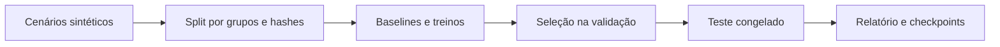

# PatchDedup

[](https://github.com/octopus-synapse/patch-dedup/actions/workflows/ci.yml)

Experimento de redundância entre bullets profissionais em português: preparação
de dados, nove treinos locais, baselines, avaliação congelada, CLI e Docker CPU.

**O refinamento não generalizou de forma confiável.** O bi-encoder selecionado por
validação teve AP 0,397 e F1 0,516 no novo holdout; a base teve AP 0,369 e F1 0,531.
O cross-encoder congelado teve AP 0,679 e F1 0,691 nesse teste, mas não venceu na
validação. Os resultados completos, inclusive falhas, estão publicados. Os dados
são sintéticos, gerados e revisados pela mesma IA, sem revisão humana.

**Uso de pesquisa. Não recomendado para exclusão automática ou avaliação de pessoas.**

[Modelo e variantes](https://huggingface.co/enzoferracini/patchdedup-ptbr-minilm)
· [Dataset](https://huggingface.co/datasets/enzoferracini/patchdedup-synthetic-ptbr)
· [Resultados v02](reports/v02/README.md)
· [Primeira bateria](reports/v01/README.md)

## O que o experimento distingue

| Par ilustrativo | Relação pretendida |
|---|---|
| “Automatizei relatórios com Python.” / “Usei Python para automatizar relatórios.” | Redundância |
| “Implementei autenticação JWT.” / “Implementei autorização por papéis.” | Contribuições distintas |
| “Implementei OAuth.” / “Implementei OAuth e recuperação de senha.” | Sobreposição parcial; preservar o fato adicional |

Os exemplos explicam a taxonomia; não são previsões fixadas manualmente.
Similaridade temática não basta para equivalência de contribuição.

## Executar

Requer Python 3.11 e [uv](https://docs.astral.sh/uv/). O núcleo de contratos e
validação não instala bibliotecas de ML:

```bash
uv sync --locked
uv run --locked patchdedup validate-data --input tests/fixtures/pairs.jsonl
uv run --locked pytest -q
```

Para inferência local em CPU, instale o extra CPU e baixe a revisão publicada:

```bash
uv sync --locked --extra cpu
# Use o SHA exato registrado em configs/release.json para reprodução.
uv run --locked --extra cpu hf download enzoferracini/patchdedup-ptbr-minilm --local-dir artifacts/model
uv run --locked --extra cpu patchdedup compare --model artifacts/model \
  --text-a 'Automatizei relatórios com Python.' \
  --text-b 'Usei Python para automatizar relatórios.'
```

O download/instalação exige rede; inferência é local. O bundle verifica hashes e
rejeita entradas longas sem truncamento silencioso. CPU é o padrão. A saída contém
cosseno, decisão, thresholds e revisões reais. Scores não são probabilidades
calibradas; a precisão seletiva observada ficou muito abaixo da meta de validação.

A main do Hub preserva o bi-encoder escolhido antes do novo teste. A branch
`v01-incumbent` preserva a inicialização dos refinamentos adicionais. A branch
`cross-encoder-frozen` disponibiliza um candidato alternativo com score separado
para decisão; ela não é uma promoção retrospectiva do vencedor do teste.

## Treino, refinamento e avaliação



A primeira bateria usou CosineSimilarityLoss e CoSENT. A adicional comparou
ContrastiveLoss, OnlineContrastiveLoss, amostragem balanceada, learning rate,
congelamento e cross-encoders. Foram nove treinos ao todo em GPU RTX A1000 6 GB,
sem jobs pagos. Resultados negativos e todas as tentativas estão registrados.

O dataset contém 724 pares únicos: 496 de treino, 72 de validação, 72 de teste
original, 36 de desafio e 48 do holdout adicional. Quatro ambíguos não entram nas
métricas binárias. Os testes antigos tornaram-se diagnósticos antes da bateria
adicional; o novo teste foi congelado antes dela. Autoria e estilo compartilhados
continuam sendo limitações. Veja [dados e licenças](data/README.md).

- [Configurações e protocolo](docs/EVALUATION.md)
- [Artigo técnico](docs/ARTICLE.md)
- [Contratos e formato dos dados](docs/CONTRACTS.md)
- [TDD e contribuição](CONTRIBUTING.md)
- [Catálogo de técnicas de ML](docs/TECHNIQUES.md)
- [Publicação e reprodução](docs/PUBLISHING.md)

## Verificação e Docker

```bash
uv run --locked ruff check .
uv run --locked ruff format --check .
uv build
# Testes de ML e checkpoint real; extras cpu e ml são mutuamente exclusivos.
PATCHDEDUP_MODEL=artifacts/model HF_HUB_OFFLINE=1 TRANSFORMERS_OFFLINE=1 \
  uv run --locked --extra cpu pytest -q
bash scripts/docker_smoke.sh artifacts/model
```

O Docker usa dependências CPU fixadas, usuário não root, modelo montado read-only
e execução `--network none`. Pesos e credenciais não entram na imagem. A CI leve
não baixa modelos; o workflow `model-smoke` é manual. A execução remota está
bloqueada pelo faturamento da conta GitHub; as verificações locais são registradas.
Nenhum orçamento ou recurso pago foi habilitado.

Código e fixtures de software: [MIT](LICENSE). Dados: CC BY 4.0. Pesos derivados:
Apache-2.0, com [avisos](licenses/NOTICE.md). Projeto independente, sem afiliação
ao iFood. Não há integração com Patch Careers, Space, API hospedada ou release
estável que prometa qualidade de produção.
