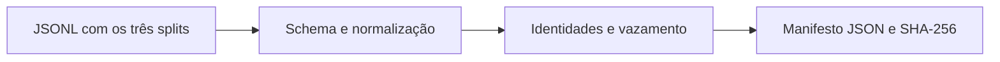

# PatchDedup

[](https://github.com/octopus-synapse/patch-dedup/actions/workflows/ci.yml)

Fundação experimental para identificar redundância entre bullets profissionais em
português brasileiro. A proposta é distinguir paráfrases de contribuições próximas
que acrescentam informação material.

**Estado: `0.1.0.dev0`.** Contratos, política de decisão e auditoria de dados estão
implementados. Ainda não há inferência, checkpoint ajustado ou benchmark. As páginas
do Hugging Face contêm cards de preparação.

| Exemplo | Relação pretendida |
|---|---|
| “Automatizei relatórios com Python.” / “Usei Python para automatizar relatórios.” | Redundância |
| “Implementei autenticação JWT.” / “Implementei autorização por papéis.” | Contribuições distintas |
| “Implementei OAuth.” / “Implementei OAuth e recuperação de senha.” | Sobreposição parcial; preservar o fato adicional |

Esses exemplos explicam a taxonomia; não são previsões do software.

## Executar

Requer Python 3.11 e [uv](https://docs.astral.sh/uv/). A instalação inicial exige
acesso ao índice de pacotes; a auditoria não usa rede nem bibliotecas de ML.

```bash
uv sync --locked
uv run --locked patchdedup --version
uv run --locked patchdedup validate-data --input tests/fixtures/pairs.jsonl
uv run --locked pytest -q
uv run --locked ruff check .
uv run --locked ruff format --check .
uv build
```

O comando escreve um manifesto JSON em stdout com SHA-256 do arquivo, contagens,
erros e avisos. Saída `0`: auditoria aprovada; `1`: dados inválidos; `2`: erro de
uso ou leitura, descrito em JSON no stderr. Não imprime os textos dos registros.

As seis [fixtures](tests/fixtures/README.md) são testes de software sem revisão de
rótulos. Aprovar a auditoria confirma invariantes estruturais; a revisão semântica,
a autorização dos dados e a independência de templates continuam necessárias.

## Arquitetura



O núcleo usa Pydantic e biblioteca padrão. `schemas` define entrada, saída e pares;
`decision` aplica thresholds explícitos; `data` audita pares/splits; `cli` expõe a
auditoria. Os schemas de comparação preparam o contrato para a inferência futura.
Não existe comando `compare` nesta etapa.

A decisão aceita somente cosseno finito em `[-1,1]`: score abaixo de `low` resulta
em `not_redundant`; a partir de `high`, `redundant`; entre ambos, `review`.
Não há thresholds operacionais padrão ou probabilidade calibrada. Valores usados
nos testes não devem orientar uso real.

## Desenvolvimento e próximos marcos

Cada comportamento segue RED → GREEN → REFACTOR antes de um commit verde em inglês
com Conventional Commits. A CI valida lockfile, lint, formatação, testes, build e
instalação do wheel fora do repositório. Nenhum job baixa modelo ou publica no Hub.

- [Contribuição e TDD](CONTRIBUTING.md)
- [Contratos e formato dos dados](docs/CONTRACTS.md)
- [Guia de anotação](docs/ANNOTATION_GUIDELINES.md)
- [Avaliação planejada e checklist](docs/EVALUATION.md)
- [Privacidade, licenças e limites](docs/ETHICS.md)
- [Especificação de referência](docs/SPECIFICATION.md)

O próximo marco é o piloto revisado de 30–50 pares, seguido de splits congelados,
baselines lexical e MiniLM original, fine-tuning, avaliação independente, CLI de
inferência e Docker CPU offline. A v0.1.0 completa também exige cards com resultados
reais e artigo técnico. A especificação preserva propostas e contexto originais;
o estado executável atual é o descrito neste README.

## Hugging Face e licença

[Modelo em preparação](https://huggingface.co/enzoferracini/patchdedup-ptbr-minilm)
· [Dataset em preparação](https://huggingface.co/datasets/enzoferracini/patchdedup-synthetic-ptbr)

Código, documentação original e fixtures: [MIT](LICENSE). A base proposta
[MiniLM multilíngue](https://huggingface.co/sentence-transformers/paraphrase-multilingual-MiniLM-L12-v2)
tem licença Apache-2.0; seus pesos não estão incluídos aqui. A licença do futuro
dataset será definida após a auditoria de proveniência. Publicação de cards é
manual: [procedimento](docs/PUBLISHING.md).

Projeto pessoal independente, sem afiliação ao iFood. Não apaga bullets, avalia
pessoas ou verifica a veracidade de experiências. Similaridade temática não prova
redundância, e nenhuma qualidade de modelo foi demonstrada nesta fundação.
