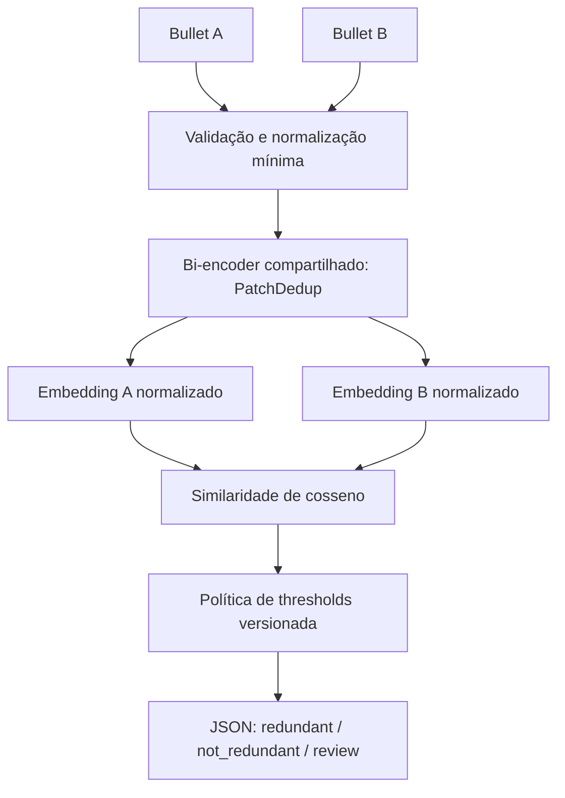
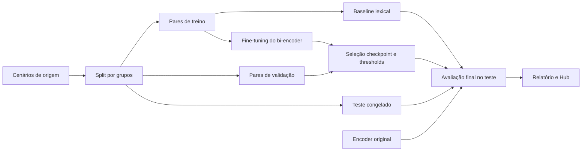

# PatchDedup

**Technical Product Requirements Document (PRD) · ML Engineering Specification · Research Plan**

| Campo | Valor |
|---|---|
| Projeto | PatchDedup |
| Versão da especificação | 1.0 (proposta para revisão) |
| Versão-alvo do modelo e contrato | 0.1.0 |
| Data-base | 15/11/2026 |
| Deadline interno de portfólio e candidatura | **16/11/2026** |
| Prazo externo de inscrição informado | **17/11/2026**; conferir portal e horário de encerramento |
| Status | Planejamento; nenhuma implementação ou resultado é declarado concluído |
| Programa motivador | iFood — Programa de Estágio GenAI, trilha AI Engineer, ref. 100233 |
| Vaga | https://carreiras.ifood.com.br/job/8901054002/ |
| Natureza | Projeto pessoal independente, não encomendado nem endossado pelo iFood |
| Idioma inicial | Português brasileiro |
| Integração com Patch Careers | Fora do escopo da v0.1 |
| Projeto precedente | PatchInsight, concluído segundo o autor; infraestrutura de ML reaproveitável |
| Modelo-base proposto | `sentence-transformers/paraphrase-multilingual-MiniLM-L12-v2` |
| Licença | Base Apache-2.0; licença dos novos artefatos após auditoria de direitos e proveniência |

> **Princípio fundamental:** semelhança semântica não equivale a redundância. Duas frases podem falar do mesmo sistema e usar as mesmas tecnologias sem comunicar a mesma contribuição profissional.

> **Política de segurança:** o PatchDedup sinaliza pares para revisão. Não apaga bullets, não inventa fatos, não verifica a veracidade de experiências e não classifica a competência de pessoas.

> **Integridade experimental:** exemplos, metas e configurações são propostas. Não há métricas, checkpoint, dataset ou publicação alegados como existentes antes da execução.

---

## 0. Contexto estratégico: iFood GenAI — AI Engineer

### 0.1 Motivação

O PatchDedup é um projeto autoral desenvolvido para fortalecer a candidatura à trilha AI Engineer do Programa de Estágio GenAI do iFood. Não é um projeto interno da empresa. Seu valor para o portfólio é demonstrar uma técnica diferente da classificação multilabel já explorada pelo PatchInsight: aprendizado de representações textuais, treinamento com pares, negativos difíceis e avaliação de similaridade orientada a uma tarefa de negócio.

A vaga descreve engenharia de software para produtos de IA e construção, ajuste e operacionalização de modelos, com ênfase em LLMs. Cita GitHub, modelos publicados no Hugging Face, pesquisa, Kaggle e artigos técnicos como exemplos de portfólio. O PatchDedup contribui com implementação de ML, checkpoint, benchmark e documentação. Não é um LLM generativo nem treinamento de foundation model do zero; não se alegará participação em Kaggle ou uso da plataforma interna Toqan.

A estratégia anterior de candidatura prioriza AI Engineer, considerando a regra de uma trilha por perfil identificada no formulário. O prazo de 17/11 é o informado no planejamento anterior; confirmar o encerramento diretamente no portal. O projeto não deve atrasar a inscrição de 16/11. A proximidade do prazo torna a entrega completa um objetivo condicionado a tempo e recursos, não uma promessa.

### 0.2 Cultura e valores

Os quatro valores oficiais do iFood, conforme a pesquisa já documentada na especificação PatchInsight v1.1, são Empreendedorismo, Resultados, Inovação e All Together. A aplicação abaixo é uma interpretação operacional proposta, não um conjunto de critérios oficiais de aprovação.

| Valor | Aplicação no PatchDedup | Evidência |
|---|---|---|
| Empreendedorismo | Assumir o ciclo de ML completo e resolver um problema do próprio produto | Decisões, código e artefatos versionados |
| Resultados | Comparar desempenho com o encoder original e medir erros que eliminariam informação útil | Benchmark, recall e precisão, análise de falsos positivos |
| Inovação | Investigar especialização de embeddings em redundância profissional, não mera paráfrase | Hipótese, treinamento, comparação com negativos difíceis |
| All Together | Documentar critérios, aceitar discordâncias de anotação e evitar viés contra estilos profissionais | Guia de anotação, revisão, Dataset Card e Model Card |

Práticas do Jeito iFood de Trabalhar (JiT) relevantes: mentalidade de dono, foco e entrega, encarar fatos, experimentação e aprendizado rápido, ambidestria e conflitos produtivos. No projeto isso significa reduzir escopo antes de reduzir qualidade, tornar erros visíveis, registrar desacordos, trabalhar com dados autorizados e publicar resultados negativos. O caráter AI First é demonstrado pela construção e avaliação de tecnologia, não pela repetição de slogans.

### 0.3 Rastreabilidade da candidatura

| Expectativa da vaga | Evidência proposta |
|---|---|
| ML no GitHub | Dataset pipeline, treino, avaliação e testes |
| Modelo no Hugging Face | Encoder especializado e Model Card |
| Pesquisa | Hipótese e comparação reproduzível com baselines |
| Artigo técnico | Relato experimental com limitações |
| Engenharia de software para IA | CLI, contrato JSON, Docker e inferência em lote |
| Kaggle | Fora do escopo; não alegar participação |

Referência cultural institucional: https://carreiras.ifood.com.br/cultura/ (consultar também o portal institucional https://institucional.ifood.com.br/). O contexto cultural deriva do documento anterior, não de uma nova auditoria completa dos princípios do JiT.

## 1. Resumo executivo

### 1.1 Problema

Ao adaptar currículos a vagas, o Patch Careers precisa selecionar contribuições relevantes dentro de um espaço limitado. Bullets escritos em momentos diferentes podem repetir a mesma realização, enquanto bullets sobre a mesma tecnologia podem representar trabalhos distintos. Um detector lexical perde paráfrases; um encoder semântico generalista pode confundir proximidade temática com equivalência de contribuição.

Exemplo redundante:
- A: Automatizei a geração de currículos utilizando filas BullMQ.
- B: Implementei filas de geração de currículos com BullMQ para automatizar o processamento.

Exemplo distinto:
- A: Implementei autenticação JWT com Spring Security.
- B: Implementei autorização granular por papéis com Spring Security.

A diferença entre os pares está na informação comunicada, não apenas no vocabulário.

### 1.2 Proposta de valor

O PatchDedup recebe dois bullets profissionais e estima se ambos comunicam a mesma contribuição sem adicionar informação material. Retorna uma relação binária operacional ou um estado de revisão, um score de similaridade e metadados de versão. A representação vetorial pode ser reutilizada para comparar muitos bullets, reduzindo a necessidade de executar um modelo conjunto para todos os pares.

Valor futuro: evitar repetição no tailoring, preservar espaço do currículo, sugerir revisão ou fusão de bullets e apoiar ranking de evidências. Nenhum desses benefícios é considerado comprovado até haver avaliação em dados representativos e medição no produto.

### 1.3 Hipótese de pesquisa

H1: o ajuste supervisionado de um bi-encoder com pares profissionais, incluindo negativos difíceis, melhora a identificação de redundância em relação ao mesmo encoder sem ajuste.

H2: a melhoria pode ser observada especificamente em pares com tecnologias e contexto semelhantes, mas contribuições diferentes.

H3 (exploratória): a especialização permite encontrar candidatos redundantes por busca vetorial sem perder demasiadas duplicatas verdadeiras. H3 não é necessária para a v0.1.

### 1.4 Sucesso da v0.1

Um checkpoint ajustado, uma avaliação independente com baselines, uma inferência local reproduzível e documentação pública. Se o modelo não superar o baseline, o resultado continua sendo um experimento válido, mas não poderá ser apresentado como melhoria comprovada nem recomendado para decisões automáticas.

## 2. Escopo e política MoSCoW

**MUST:** requisito de conclusão da v0.1 completa. **SHOULD:** desejável após o núcleo. **COULD:** exploração opcional. **WON'T:** explicitamente fora desta versão. Esta matriz é proposta pelo assistente; não foi aprovada item a item pelo autor, ao contrário da matriz do PatchInsight.

### 2.1 Requisitos funcionais: REQ-SEM

| ID | Requisito | MoSCoW | Critério de aceite |
|---|---|---|---|
| SEM-01 | Receber dois bullets em PT-BR | MUST | Validar dois textos não vazios e preservar informação textual |
| SEM-02 | Identificar redundância semântica | MUST | Produzir decisão para cada par elegível |
| SEM-03 | Distinguir contribuições diferentes no mesmo contexto | MUST | Avaliar negativos difíceis em conjunto independente |
| SEM-04 | Detectar paráfrases com pouca sobreposição lexical | MUST | Incluir e reportar esse subconjunto no teste |
| SEM-05 | Preservar informação material exclusiva | MUST | Pares com fato adicional relevante não são positivos na taxonomia binária |
| SEM-06 | Tratar ordem dos textos simetricamente | MUST | Score e decisão invariantes à troca, dentro da tolerância numérica |
| SEM-07 | Retornar similaridade de cosseno | MUST | Valor finito no intervalo [-1,1], documentado como similaridade e não probabilidade |
| SEM-08 | Reconhecer sobreposição parcial explicitamente | SHOULD | Relato de diagnóstico separado quando houver dados/modelo adequado |
| SEM-09 | Sinalizar casos inconclusivos | MUST | Estado `review` por faixa de decisão, sem alegar calibração |
| SEM-10 | Detectar contradições explícitas | COULD | Avaliar separadamente; não usar score como verificador factual |
| SEM-11 | Identificar trechos comuns e exclusivos | COULD | Explicação textual avaliada, não simulada por score |
| SEM-12 | Comparar bullets PT/EN | SHOULD | Teste bilíngue próprio; base multilíngue não basta para validar suporte |
| SEM-13 | Fundir ou reescrever bullets | WON'T | Nenhuma geração na v0.1 |
| SEM-14 | Excluir automaticamente experiências | WON'T | Nenhuma mutação de currículo |
| SEM-15 | Avaliar competência, senioridade ou veracidade | WON'T | Documentar como uso não pretendido |

### 2.2 Dados e Machine Learning: REQ-ML

| ID | Requisito | MoSCoW | Critério de aceite |
|---|---|---|---|
| ML-01 | Modelo-base Sentence Transformer | MUST | ID, revisão, licença e configuração registrados |
| ML-02 | Dataset supervisionado de pares | MUST | Pares revisados com rótulos e origem |
| ML-03 | Guia de anotação | MUST | Definição de redundância, casos-limite e exemplos |
| ML-04 | Divisão por grupos de experiência/cenário | MUST | Nenhum texto, família ou paráfrase próxima cruza splits |
| ML-05 | Negativos difíceis | MUST | Mesmo projeto/tecnologia com ações distintas, fatos adicionais e números diferentes |
| ML-06 | Baseline lexical | MUST | TF-IDF + cosseno ou similaridade de n-gramas, parâmetros documentados |
| ML-07 | Baseline encoder original | MUST | Mesmo modelo, sem ajuste, threshold próprio de validação |
| ML-08 | Fine-tuning supervisionado do encoder | MUST | Pesos efetivamente atualizados e checkpoint salvo |
| ML-09 | Avaliação independente | MUST | Teste congelado, sem seleção de parâmetros usando teste |
| ML-10 | Métricas de classificação e ranking | MUST | Precision, recall, F1, matriz de confusão, AP/PR-AUC conforme definição |
| ML-11 | Análise de erros | MUST | Falsos positivos e negativos reais, com categorias |
| ML-12 | Reprodutibilidade | MUST | Seed, dependências, revisões, configuração e manifestos |
| ML-13 | Comparar CosineSimilarityLoss e CoSENTLoss | SHOULD | Experimento controlado com mesmo split |
| ML-14 | Calibrar probabilidades | COULD | Conjunto de validação e métrica de calibração; fora do score básico |
| ML-15 | Mineração automática de negativos | SHOULD | Somente treino, revisão de falsos negativos |
| ML-16 | Dataset independente escrito por humanos | SHOULD | Conjunto com proveniência e avaliação separada |
| ML-17 | Cross-encoder como reranker | COULD | Comparar ganho com custo de inferência |
| ML-18 | Treinamento de foundation model do zero | WON'T | Não previsto |
| ML-19 | Treino multitarefa com PatchInsight | WON'T | Modelos independentes |

### 2.3 Engenharia: REQ-ENG

| ID | Requisito | MoSCoW | Critério de aceite |
|---|---|---|---|
| ENG-01 | Inferência local CLI | MUST | Executar par com checkpoint local sem API externa |
| ENG-02 | JSON versionado | MUST | Schema validado, campos e estados documentados |
| ENG-03 | Testes automatizados | MUST | Validação, simetria, thresholds, casos-limite e smoke test |
| ENG-04 | Docker de inferência | MUST | Imagem reproduzível, usuário não root, modelo local |
| ENG-05 | Inferência em lote | SHOULD | Comparar vários pares com batch configurável |
| ENG-06 | Comparação de lista de bullets | SHOULD | Emitir pares suspeitos, sem excluir itens |
| ENG-07 | API REST | SHOULD | Contrato OpenAPI e validação de entrada |
| ENG-08 | Demo interativa | SHOULD | Exemplos e entrada livre; inferência real |
| ENG-09 | Cache de embeddings | COULD | Chave contém hash do texto e revisão do modelo |
| ENG-10 | Busca ANN/índice vetorial | COULD | Benchmark recall@k e custo |
| ENG-11 | ONNX/quantização | COULD | Comparar latência, memória e perda de qualidade |
| ENG-12 | Observabilidade de produção | WON'T | Sem infraestrutura de produção nesta fase |
| ENG-13 | Integração ao Patch Careers | WON'T | Nenhuma dependência ou alteração do produto |

### 2.4 Publicação: REQ-PUB

| ID | Requisito | MoSCoW | Critério de aceite |
|---|---|---|---|
| PUB-01 | GitHub público | MUST | Código de treino, avaliação, inferência e README |
| PUB-02 | Checkpoint no Hugging Face | MUST | Artefato carregável e revisão identificável |
| PUB-03 | Model Card | MUST | Uso, dados, métricas, riscos, limitações e licença |
| PUB-04 | Dataset Card | MUST | Taxonomia, origem, splits e restrições |
| PUB-05 | Benchmark reproduzível | MUST | Comandos, métricas e configuração executável |
| PUB-06 | Artigo técnico | MUST | Hipótese, método, resultados e limitações reais |
| PUB-07 | Ética e privacidade | MUST | Não publicar dados pessoais não autorizados |
| PUB-08 | Dataset no Hub | SHOULD | Somente dados redistribuíveis |
| PUB-09 | Hugging Face Space | COULD | Demo hospedada, se não atrasar núcleo |
| PUB-10 | Kaggle | WON'T | Nenhuma participação fictícia |

### 2.5 Caminho crítico

ML-03 → ML-02/04/05 → ML-06/07 → ML-08 → ML-09/10/11 → ENG-01/02/03 → PUB-01/02/03/05/06. Docker e documentação podem reutilizar padrões do PatchInsight. A v0.1 completa exige os MUST; se o prazo imediato impedir algum deles, publicar como protótipo experimental incompleto com checklist transparente, não rebaixar requisitos silenciosamente.

## 3. Taxonomia de redundância e protocolo de anotação

### 3.1 Unidade e definição

Um par de bullets (A,B), idealmente do mesmo histórico profissional ou de um cenário fictício coerente. O rótulo positivo representa equivalência de contribuição comunicada: mesma ação ou entrega, mesmo objeto e contexto compatível, sem informação material exclusiva que seria perdida se uma das descrições fosse omitida. Não significa que a experiência seja verdadeira.

O modelo recebe apenas o texto. Quando a equivalência depende de identidade de projeto ou de fatos não fornecidos, a anotação deve reconhecer a ambiguidade em vez de inventar contexto. Dois textos literalmente iguais podem descrever projetos diferentes; isso não é resolvível apenas por linguagem. O uso futuro deve restringir comparações a contexto apropriado.

### 3.2 Rótulos de anotação e mapeamento

| Rótulo humano | Definição | Mapeamento no treino binário |
|---|---|---|
| `redundant` | Mesma contribuição; diferenças são paráfrase ou detalhe não material | 1 |
| `distinct` | Ações, objetos, entregas ou resultados materialmente diferentes | 0 |
| `partial_overlap` | Núcleo em comum, mas há informação material exclusiva em pelo menos um texto | 0 |
| `contradictory` | Alegações incompatíveis, por exemplo duas métricas diferentes para a mesma medida | 0 |
| `ambiguous` | Não há contexto suficiente ou a decisão é genuinamente inconclusiva | Excluir do treino binário; avaliar separadamente |

A v0.1 não promete reconhecer os cinco rótulos em inferência. Eles existem para anotação e análise de erros. As saídas operacionais são `redundant`, `not_redundant`, `review`. O estado `review` é uma decisão de política baseada no score, não previsão de uma classe `ambiguous` aprendida.

### 3.3 Critérios de materialidade

Informação material é uma distinção que pode mudar o que um leitor entende sobre contribuição, escopo, tecnologia aplicada, papel, resultado, métrica, público ou sistema. Remover um bullet não pode apagar um fato profissional relevante. Não exigir métrica para definir uma realização. Não tratar senioridade ou termos grandiosos como qualidade.

- Sinônimos e mudanças gramaticais sem novo fato: redundante.
- Ações diferentes no mesmo produto: distinto.
- Mesmo resultado com método novo explicitado em apenas um texto: sobreposição parcial.
- Um texto contém 30% e outro 50% para a mesma melhoria: contraditório, se contexto e medida forem iguais.
- Uma frase diz "liderei" e outra "participei": não assumir equivalência; avaliar se o contexto deixa o papel compatível, senão parcial/ambíguo.
- "Desenvolvi 3 APIs" vs "Desenvolvi APIs": parcial se a quantidade for material.
- Mesmo texto em duas experiências diferentes: ambíguo ou distinto quando o contexto é conhecido; não inferir identidade do evento.
- Métricas temporais equivalentes por conversão (60 min e 1 h): podem ser redundantes se todo o restante for equivalente.

### 3.4 Exemplos rotulados (ilustrativos)

| A | B | Rótulo | Razão |
|---|---|---|---|
| Automatizei relatórios com Python. | Usei Python para automatizar a emissão de relatórios. | redundant | Mesma ação e objeto |
| Criei filas BullMQ para exportar currículos. | Implementei processamento assíncrono de exportação com BullMQ. | redundant | Paráfrase da entrega |
| Implementei autenticação JWT. | Desenvolvi autorização por papéis. | distinct | Funções distintas |
| Criei cache Redis para consultas. | Configurei Redis como broker de workers. | distinct | Mesma ferramenta, uso diferente |
| Implementei autenticação OAuth. | Implementei OAuth e recuperação de senha. | partial_overlap | Segunda entrega adicional |
| Reduzi latência em 40% com cache. | Reduzi latência em 40% com cache Redis e invalidação por evento. | partial_overlap | Método mais específico |
| Reduzi latência em 40% com cache. | Reduzi latência em 70% com cache. | contradictory | Métrica divergente, supondo mesmo indicador e cenário |
| Ajudei no desenvolvimento da API. | Liderei o desenvolvimento da API. | ambiguous | Papel não resolvido pelo texto |
| Trabalhei com sistemas internos. | Desenvolvi um sistema interno de estoque. | partial_overlap | Especificidade material exclusiva |
| Organizei treinamento de atendimento. | Capacitei a equipe para atender clientes. | ambiguous | Não se sabe se foi a mesma atividade |

### 3.5 Processo de anotação

1. Criar um cenário com fatos de origem, entidades fictícias e limites claros.
2. Escrever contribuições distintas e paráfrases; não gerar todos os negativos pela mesma regra.
3. Anotar relação, razão, categoria de dificuldade e grupo de cenário.
4. Revisar pares sem ver sugestão automática de rótulo quando possível.
5. Adjudicar desacordos, registrar mudanças do guia e congelar versão.
6. Se houver apenas um anotador, repetir revisão de amostra cega em momento distinto; não declarar concordância interanotador inexistente.

Pilotar 30–50 pares antes de expandir. Com dois anotadores, reportar concordância bruta e Cohen's kappa (com limitações da distribuição). Excluir casos irresolvíveis do treino binário, mantendo contagem e exemplos no relatório.

## 4. Arquitetura técnica

### 4.1 Visão lógica



O mesmo encoder e os mesmos pesos processam A e B independentemente. Isso é importante: o modelo aprende um espaço vetorial, permitindo reuso de embeddings. A decisão é simétrica. Não é um cross-encoder que lê os dois textos conjuntamente. O trade-off é que relações sutis entre números e papéis podem ser mais difíceis para um único vetor por texto.

### 4.2 Modelo e stack

Modelo-base proposto: `sentence-transformers/paraphrase-multilingual-MiniLM-L12-v2`, Sentence Transformer de embeddings de 384 dimensões, com suporte multilíngue e licença Apache-2.0 conforme Model Card. Fixar a revisão Git do Hub. Suporte multilíngue da base não comprova desempenho em inglês no modelo especializado. O comprimento máximo deve respeitar a configuração efetiva do checkpoint (tipicamente 128 tokens neste modelo); validar em runtime e documentar. Não truncar silenciosamente entradas que possam perder informação material.

| Camada | Tecnologia |
|---|---|
| Linguagem | Python 3.11 ou versão compatível com lockfile |
| ML | PyTorch, sentence-transformers, Transformers, datasets |
| Métricas | scikit-learn, NumPy |
| Contratos | Pydantic |
| Testes | pytest |
| Reprodutibilidade | uv/lockfile ou equivalente; GitHub Actions |
| Inferência | CLI Python; FastAPI opcional |
| Container | Docker CPU, sem privilégios |
| Publicação | Hugging Face Hub, GitHub |

### 4.3 Treino e avaliação



Não usar teste para escolher loss, epoch, threshold ou base. Cada baseline recebe suas próprias decisões calibradas na validação. O encoder original é avaliado com o mesmo protocolo e dados. A anotação e os scripts de comparação são separados do serviço de inferência.

### 4.4 Privacidade e segurança

Dados sintéticos ou autorizados. Não copiar currículos de terceiros, LinkedIn ou bancos de candidatos sem base legítima e autorização de redistribuição. Dados de origem e nomes reais não devem entrar em artefatos públicos inadvertidamente. O projeto deve funcionar offline, sem transmitir bullets a APIs externas durante inferência. Não registrar texto de usuário em logs por padrão. Limitar tamanho de entrada, batch, tempo e memória. Entradas são dados, não instruções; nenhum comando é executado a partir delas.

## 5. Dataset: desenho, volume e controle de qualidade

### 5.1 Metas realistas

Meta de MVP completo: 400–600 pares revisados, com aproximadamente 80–120 grupos de cenário independentes. Meta emergencial: 180–250 pares, 30–50 grupos, mantendo teste independente suficiente para revelar erros. O número de pares não equivale ao número de experiências independentes. Estas metas são estimativas de planejamento, não garantias de generalização.

| Split | Fração proposta | Exemplo para 400 pares |
|---|---|---|
| Treino | 70% | 280 |
| Validação | 15% | 60 |
| Teste | 15% | 60 |

As quantidades reais podem variar para manter grupos intactos. Se o conjunto for muito pequeno, relatar intervalos amplos, contagens e caráter piloto. Não inventar métricas estáveis a partir de poucos exemplos.

### 5.2 Composição proposta

- 40–50% positivos, distribuídos entre paráfrase lexical alta, baixa e variação de sintaxe.
- 50–60% negativos; pelo menos metade dos negativos deve ser difícil (mesmo domínio, projeto ou termos técnicos).
- Incluir sobreposição parcial, conflito de métricas, papéis distintos, ações distintas e casos fáceis de domínios diferentes.
- Incluir software, operações, atendimento, comércio, educação e outras áreas. Evitar que palavras específicas de TI revelem o rótulo.
- Manter casos ambíguos separados; não forçar rótulo para equilibrar classes.
- Teste com estilos, comprimentos e cenários não vistos; preferir exemplos escritos/revisados independentemente.

### 5.3 Registro JSONL

```json
{
  "pair_id": "ptbr-p0001",
  "scenario_id": "scenario-0042",
  "text_a_id": "bullet-0042-a",
  "text_b_id": "bullet-0042-b",
  "text_a": "Automatizei a exportação de currículos com BullMQ.",
  "text_b": "Implementei filas BullMQ para automatizar a exportação de currículos.",
  "relation": "redundant",
  "binary_label": 1,
  "difficulty": "paraphrase",
  "domain": "software",
  "language": "pt-BR",
  "source_type": "synthetic",
  "review_status": "reviewed",
  "annotation_version": "0.1.0",
  "split": "train"
}
```

Para `ambiguous`, `binary_label` é null. Guardar justificativas no manifesto de anotação, não como entrada de treinamento. Não incluir identificadores pessoais. Para pares de cenários diferentes, registrar ambos os IDs; nenhum cenário pode pertencer a splits distintos. A maneira mais simples é alocar cenários primeiro e formar pares somente dentro de cada split. Se pares preexistentes ligarem grupos, particionar componentes conexos do grafo de identidades.

### 5.4 Prevenção de leakage

- Dividir cenários antes de criar paráfrases e pares.
- Nunca distribuir A/B e B/A em splits diferentes; canonicalizar IDs de par.
- Verificar hashes de texto normalizado, duplicatas exatas e similaridade lexical/semântica elevada entre splits; revisar alertas.
- Separar famílias de templates sintéticos quando elas revelarem o rótulo; preferir teste com templates e autores independentes.
- Não usar o teste na mineração de negativos, na geração de novos exemplos ou na revisão de hiperparâmetros.
- Se leakage for descoberto após olhar o teste, invalidar a avaliação e criar novo teste independente; não tratar o teste antigo como novo holdout.

### 5.5 Pipeline de dados

`raw/scenarios.jsonl` → validação de schema → split de cenários → construção de pares → anotação → adjudicação → validação de leakage → `processed/{train,validation,test}.jsonl` → manifestos SHA-256 e contagens. Registrar ferramenta de geração sintética, versão de prompt e revisão humana quando utilizada. A Dataset Card deve distinguir geração sintética de anotação humana e explicar limites de redistribuição.

### 5.6 Aceite

IDs únicos, rótulos válidos, mapeamento consistente, todos os splits com positivos e negativos, nenhum cruzamento de grupo ou duplicata conhecida, teste congelado com hash, contagem por categoria e exemplos de divergência. Dataset não precisa ser publicado se restrito, mas benchmark público precisa incluir dados redistribuíveis ou explicar a restrição e fornecer subconjunto reproduzível.

## 6. Formulação de ML e fine-tuning

### 6.1 Problema formal

Seja fθ(t) o embedding de um bullet. Normalizar por L2: e(t)=fθ(t)/||fθ(t)||. A similaridade s(A,B)=e(A)·e(B), em [-1,1]. Com pesos compartilhados, s(A,B)=s(B,A). O alvo y∈{0,1} representa redundância conforme a taxonomia, não similaridade genérica nem probabilidade de identidade factual.

### 6.2 Baselines

1. **Lexical:** TF-IDF de caracteres (n-gramas 3–5) e/ou palavras; cosseno. Ajustar vocabulário exclusivamente no treino. Escolher threshold na validação.
2. **Encoder original:** embeddings do MiniLM multilíngue sem ajuste; cosseno, mesma política de validação.
3. **Experimento:** mesmo checkpoint após fine-tuning em pares profissionais. Comparar com 1 e 2 no teste congelado.

Opcional: regressão logística sobre features simétricas de embeddings congelados, para distinguir efeito de ajustar pesos do efeito de uma camada de decisão. Não confundir esse baseline com fine-tuning do encoder.

### 6.3 Loss e escolha inicial

Usar `CosineSimilarityLoss` com rótulos 0/1 para o primeiro experimento: MSE entre cosseno e rótulo. Positivos aproximam embeddings; negativos recebem alvo zero (ortogonalidade aproximada, não necessariamente cosseno -1). É simples, recebe explicitamente negativos difíceis e permite reaproveitar pipeline de pares.

Should Have: `CoSENTLoss`, que incentiva ordenação de scores conforme rótulos. Comparar no mesmo split e com orçamento de treino documentado. Não afirmar superioridade sem medir. Se houver necessidade de uma margem explícita, experimentar `ContrastiveLoss` em versão posterior, documentando convenção de distância e rótulos da biblioteca.

Não usar MultipleNegativesRankingLoss como padrão inicial: pares do mesmo contexto podem ser falsos negativos em batch. Uma versão posterior pode utilizá-la com grupos e amostragem controlada. Não usar LoRA só para adicionar uma palavra-chave; o modelo é um encoder relativamente pequeno, e full fine-tuning é a primeira proposta, condicionado a hardware.

### 6.4 Hiperparâmetros iniciais

| Parâmetro | Proposta |
|---|---|
| Base | paraphrase-multilingual-MiniLM-L12-v2, revisão fixada |
| Loss | CosineSimilarityLoss |
| Epochs | 1–3, seleção em validação |
| Learning rate | 2e-5 inicial |
| Batch size | 8–16, ajustar à memória |
| Max sequence length | Configuração do checkpoint, verificar antes do treino |
| Optimizer | AdamW |
| Warmup | 0–10%, se adequado ao número de passos |
| Seed | 42 inicial; registrar |
| Seleção | AP de validação ou F1 binário com threshold derivado na validação; escolher antes do teste |
| Hardware | GPU preferível; CPU para piloto pequeno, sem promessa de tempo |

Usar precisão mista apenas se suportada. Registrar versão do PyTorch, driver, GPU/CPU, duração real, passos, loss e checkpoint. Executar smoke test com poucos pares antes da rodada completa. Se memória insuficiente, reduzir batch/usar acumulação ou congelar parte das camadas e declarar a estratégia. Treinar apenas uma cabeça sobre encoder congelado é baseline, não o experimento principal pretendido.

### 6.5 Esqueleto de treinamento (ilustrativo)

```python
from sentence_transformers import SentenceTransformer, SentenceTransformerTrainer, SentenceTransformerTrainingArguments, losses
from datasets import Dataset

model = SentenceTransformer(BASE_ID, revision=BASE_REVISION)
train_ds = Dataset.from_dict({
    "sentence1": train_a,
    "sentence2": train_b,
    "score": [float(y) for y in train_y],
})
loss = losses.CosineSimilarityLoss(model)
args = SentenceTransformerTrainingArguments(
    output_dir="artifacts/checkpoints",
    num_train_epochs=3,
    per_device_train_batch_size=8,
    learning_rate=2e-5,
    seed=42,
    save_strategy="epoch",
)
trainer = SentenceTransformerTrainer(model=model, args=args,
    train_dataset=train_ds, loss=loss)
trainer.train()
# Avaliar checkpoints na validação e selecionar antes do teste.
```

O trecho não é um script executado ou testado. Implementação final deve fixar versões, carregar os splits reais, registrar métricas e selecionar checkpoint via validação. Verificar assinatura da biblioteca instalada; não usar nomes de colunas adicionais inadvertidamente como entradas.

### 6.6 Reprodutibilidade e contingência

Salvar config YAML, lockfile, hashes dos dados, revisão da base, seed, comandos, commit Git, checkpoint, `thresholds.json` e métricas brutas. A escolha final de modelo e threshold deve ser reproduzível. Caso não seja possível treinar até o prazo, publicar baseline e código como trabalho em andamento e declarar que não há checkpoint especializado; jamais renomear pesos da base como modelo treinado.

## 7. Política de decisão e reconhecimento de redundância

### 7.1 Thresholds

Definir τ_low < τ_high em validação. Se s≥τ_high: `redundant`. Se s<τ_low: `not_redundant`. Caso contrário: `review`. Valores ilustrativos como 0.65/0.85 não são defaults validados; não publicar como thresholds finais sem seleção experimental.

A decisão de alta similaridade deve favorecer precisão para reduzir falsos positivos que sinalizariam remoção de fatos relevantes. Selecionar τ_high maximizando recall entre candidatos que atingem uma meta de precisão de validação (por exemplo 0.90, meta proposta, com suporte mínimo e intervalo de incerteza reportado). Se não houver threshold útil, desabilitar a decisão automática de redundância e encaminhar casos para revisão. τ_low pode ser escolhido para limitar falsos negativos entre decisões negativas. Reportar cobertura e taxa de revisão.

Para benchmark binário, manter também τ_binary escolhido em validação por F1 ou objetivo predefinido. Separar métricas binárias de métricas seletivas com abstention. A classe review não deve ser removida do denominador sem informar cobertura.

### 7.2 Casos especiais

Texto idêntico tem cosseno próximo de 1, mas não prova que dois eventos são os mesmos; se o contexto for desconhecido, documentar a restrição de uso. Texto vazio ou truncado não gera decisão silenciosa. Números diferentes e negação podem ser sinais de risco, mas a v0.1 não implementa verificação factual determinística; medir esses erros. Uma regra opcional de revisão para divergência de números pode ser avaliada separadamente, nunca misturada ao resultado puro do encoder.

### 7.3 Listas e agrupamento futuro

Para n bullets, gerar embeddings uma vez e matriz de cosseno; custo de comparação O(n²), armazenamento O(n²) se materializada. Para currículos pequenos é suficiente. Retornar pares, não grupos transitivos automáticos: A semelhante a B e B semelhante a C não garante A equivalente a C. Futuro agrupamento requer critérios de equivalência mais fortes e revisão humana. ANN é desnecessário para o MVP.

## 8. Contratos JSON versionados

### 8.1 Entrada

```json
{
  "schema_version": "0.1.0",
  "language": "pt-BR",
  "text_a": "Implementei autenticação JWT com Spring Security.",
  "text_b": "Desenvolvi autorização por papéis com Spring Security."
}
```

Validar UTF-8, dois textos não vazios, comprimento em caracteres e tokens, ausência de truncamento silencioso, idioma declarado dentro do escopo. Limite de caracteres inicial 1500 por texto, mas limite efetivo é também o de tokens. Normalizar espaços e Unicode NFC; preservar caixa quando tokenizer exigir, pontuação, números, negação e tecnologias.

### 8.2 Saída

```json
{
  "schema_version": "0.1.0",
  "model_version": "0.1.0",
  "model_revision": "example-revision",
  "decision_policy_version": "0.1.0",
  "language": "pt-BR",
  "similarity": {"metric": "cosine", "score": 0.72},
  "decision": "review",
  "thresholds": {"low": 0.65, "high": 0.85},
  "requires_review": true,
  "warnings": ["semantic_similarity_is_not_factual_equivalence"]
}
```

Valores fictícios para ilustrar contrato. Não são resultados nem parâmetros calibrados. `similarity.score` é cosseno, não probabilidade, percentual de igualdade ou nota de qualidade. `decision` é um enum. `requires_review` deve ser true para `review`; decisões positivas continuam sendo sugestões, sem exclusão automática. O campo de revisão real deve identificar commit do Hub ou hash do artefato.

### 8.3 Erros e versões

Erros de validação retornam código estável (`EMPTY_TEXT`, `INPUT_TOO_LONG`, `UNSUPPORTED_LANGUAGE`, `MODEL_UNAVAILABLE`, `INVALID_SCORE`) e mensagem não sensível. CLI retorna exit code não zero. REST opcional usa 422 para entrada inválida e 503 para modelo indisponível. Nenhum fallback silencioso para encoder diferente. Versionar schema, pesos, tokenizer e política de thresholds independentemente; alterações incompatíveis exigem mudança de versão documentada.

## 9. Avaliação experimental

### 9.1 Métricas

| Métrica | Objetivo |
|---|---|
| Precision positiva | Quantos pares sinalizados como redundantes são realmente redundantes |
| Recall positivo | Quantas redundâncias reais são encontradas |
| F1 | Equilíbrio precision/recall no threshold binário |
| Macro-F1 | Visão das duas classes |
| Average Precision (AP) | Qualidade do ranking de scores para a classe positiva |
| Matriz de confusão | Contagem explícita TP, FP, TN, FN |
| FPR em negativos difíceis | Risco de confundir contribuições próximas |
| Cobertura seletiva | Fração decidida fora de review |
| Precision seletiva | Precisão entre positivos decididos pela política |
| Taxa de revisão | Volume encaminhado a revisão humana |

AP é a definição da métrica de ranking escolhida; não chamar de área trapezoidal sob PR sem especificar. Reportar prevalência e suporte por categoria. Se houver poucos grupos, mostrar contagens e, quando viável, bootstrap por grupo (não por pares dependentes). Não prometer significância estatística com dataset piloto.

### 9.2 Protocolo

1. Congelar test manifest.
2. Treinar baselines e modelo usando treino.
3. Escolher checkpoint, thresholds e política com validação.
4. Executar uma rodada final de avaliação no teste para cada abordagem.
5. Salvar scores e decisões por `pair_id` em CSV/JSONL sem dados pessoais.
6. Gerar tabela de métricas, análise por categoria e exemplos de erros.
7. Não modificar modelo com base no teste e repetir a mesma avaliação como independente.

### 9.3 Tabela de resultados (preencher somente após execução)

| Modelo | AP | F1 | Precision | Recall | FPR hard negatives | Cobertura |
|---|---|---|---|---|---|---|
| TF-IDF | — | — | — | — | — | — |
| MiniLM original | — | — | — | — | — | — |
| PatchDedup fine-tuned | — | — | — | — | — | — |

### 9.4 Testes adversariais obrigatórios

- Mesmo vocabulário, ação distinta: autenticação vs autorização.
- Mesmo objeto, tecnologia distinta que altera a contribuição.
- Mudança de número: 40% vs 70%, 2 horas vs 20 horas.
- Negação: implementei vs não implementei.
- Acréscimo de fato: OAuth vs OAuth + recuperação de senha.
- Paráfrase distante: automatizei cobrança vs eliminei envio manual de lembretes, com contexto suficiente.
- Contexto insuficiente: descrições genéricas e repetidas.
- Variação de ordem, acentuação e espaços.

Cada caso recebe rótulo e explicação humana. Não assumir que um encoder resolve números, negação ou identidade de eventos. Reportar falhas explicitamente.

### 9.5 Análise de erros

Classificar FP/FN em sobreposição temática, perda de detalhes, métrica/negação, mudança de papel, frase curta/vaga, domínio não visto e anotação discutível. Mostrar pelo menos alguns exemplos representativos por tipo disponível, não selecionar apenas sucessos. Discutir se a causa é modelo, taxonomia, dados ou threshold. Limitação principal: dados sintéticos podem ser mais regulares que currículos reais.

### 9.6 Interpretação de sucesso

A hipótese é sustentada se houver melhoria coerente frente ao encoder original no teste, especialmente nos negativos difíceis, sem sacrificar excessivamente recall. Não exigir 95% de F1. Se resultados forem inconclusivos, declarar isso. Para eventual implantação, exigir avaliação adicional em dados representativos autorizados, thresholds definidos pelo risco e validação humana. O benchmark inicial não mede conversão de candidaturas nem horas economizadas.

## 10. Engenharia, testes e Docker

### 10.1 Repositório

```text
patchdedup/
├── configs/
│   ├── minilm.yaml
│   └── thresholds.json
├── data/
│   ├── raw/
│   ├── processed/
│   └── manifests/
├── docs/
│   ├── ANNOTATION_GUIDELINES.md
│   ├── DATASET_CARD.md
│   ├── MODEL_CARD.md
│   ├── EVALUATION.md
│   ├── ETHICS.md
│   └── ARTICLE.md
├── src/patchdedup/
│   ├── data.py
│   ├── training.py
│   ├── evaluation.py
│   ├── encoder.py
│   ├── decision.py
│   ├── schemas.py
│   └── cli.py
├── scripts/
│   ├── prepare_dataset.py
│   ├── train.py
│   ├── evaluate.py
│   └── publish.py
├── tests/
├── reports/
├── artifacts/              # ignorar pesos grandes no Git
├── .github/workflows/ci.yml
├── Dockerfile
├── pyproject.toml
├── uv.lock
├── README.md
└── LICENSE
```

Estrutura sugerida; adaptar ao padrão real do PatchInsight após consultar seu repositório, sem assumir que já existe cada arquivo. Não duplicar infraestrutura desnecessariamente.

### 10.2 CLI e inferência

```bash
# Interface proposta, não comandos já implementados
uv sync --locked
uv run python scripts/prepare_dataset.py --config configs/minilm.yaml
uv run python scripts/train.py --config configs/minilm.yaml
uv run python scripts/evaluate.py --config configs/minilm.yaml --split test
uv run patchdedup compare --model artifacts/model --text-a 'Criei filas BullMQ.' --text-b 'Implementei filas com BullMQ.'
```

Carregar modelo uma vez, usar `eval()` e inference mode, normalizar embeddings e computar cosseno. Inferência CPU por padrão; batch opcional. Garantir que config e tokenizer acompanhem pesos. Cache futuro indexado por revisão do encoder e hash do texto; não misturar embeddings de versões diferentes.

### 10.3 Testes

| Teste | Aceite |
|---|---|
| Schema | Entrada inválida rejeitada; saída válida conforme contrato |
| Split | Nenhum cenário ou texto cruza conjuntos |
| Canonicalização | A/B e B/A tratados como mesmo par lógico |
| Simetria | Scores iguais dentro de tolerância definida |
| Normalização | Números e negações preservados; sem divisão por zero |
| Threshold | Bordas low/high e review testadas |
| Score | Finito, intervalo válido, erros tratados |
| Smoke de treino | Pequeno batch completa forward/backward e salva checkpoint |
| Smoke de inferência | Checkpoint real carrega e produz JSON |
| Docker offline | Executa sem rede com modelo local e usuário não root |
| Reprodutibilidade | Comandos e hashes do benchmark conferidos |

Não usar inferências fixadas manualmente em demo apresentada como modelo real. Testes unitários podem usar mock, mas smoke test de integração precisa carregar pesos reais. CI pode executar testes leves sem baixar modelo a cada commit; pipeline separado para smoke de checkpoint.

### 10.4 Docker

Imagem CPU, dependências fixadas, usuário não root, checkpoint copiado ou montado em volume read-only. Não embutir credenciais do Hub. Usar modo offline do Hugging Face/Transformers conforme biblioteca e testar `--network none`. Documentar tamanho de imagem e procedimento de build. Não instalar dependências de treino pesadas sem necessidade. Exemplo de contrato operacional:

```bash
docker build -t patchdedup:0.1.0 .
docker run --rm --network none -v "$PWD/artifacts/model:/model:ro" patchdedup:0.1.0 compare --model /model --text-a 'A' --text-b 'B'
```

O Dockerfile e os comandos são planejados, não validados por esta especificação.

### 10.5 API e demo (SHOULD)

`POST /v1/compare` aceita schema de entrada, retorna saída JSON. `GET /health` opcional. Inicializar encoder uma vez no startup. Demo mínima com dois campos de texto, botão de comparar, score, decisão e explicação dos limites. Não criar frontend complexo. Se tempo insuficiente, CLI e README com exemplos reais bastam para o núcleo; Docker continua MUST da versão completa.

## 11. Publicação e comunicação científica

### 11.1 Hugging Face

Publicar o diretório completo de `SentenceTransformer.save_pretrained` ou equivalente verificado, incluindo módulos, tokenizer, configuração e pesos safetensors quando suportado. Testar recarregamento de revisão publicada. Incluir `thresholds.json` e instruções de decisão, embora o checkpoint isolado apenas produza embeddings. Não declarar que `SentenceTransformer.encode` retorna classes.

Nome sugerido: `<namespace>/patchdedup-ptbr-minilm`. Não é um repositório existente ou reservado. Revisar licença Apache-2.0 da base, preservar avisos requeridos, escolher licença compatível para código e dados e auditar direitos dos exemplos. Não publicar token, PII ou dados privados.

### 11.2 Model Card

Metadados: `library_name: sentence-transformers`, `pipeline_tag: sentence-similarity`, idioma `pt`, `base_model` e licença confirmada. Incluir:
- finalidade e definição operacional de redundância;
- arquitetura, revisão da base, treino e hardware;
- dataset, rótulos, split por grupos e origem;
- métricas reais, baselines, thresholds e cobertura;
- uso pretendido para revisão textual de currículos; usos proibidos/não recomendados;
- limitações em números, negação, sobreposição parcial, contexto e dados sintéticos;
- instruções para carregar modelo e aplicar política; exemplo real reproduzível;
- autoria independente, sem afiliação ao iFood.

### 11.3 Dataset Card

Descrever quantidade real, grupos, distribuição, idiomas, domínios, geração/anotação, exclusões, direitos e licença. Explicar por que `partial_overlap` e `contradictory` são negativos, enquanto `ambiguous` é excluído. Indicar possíveis vieses por domínio e fonte sintética. Publicar dados somente com autorização; se não publicar, fornecer subset público e script de reprodução compatível.

### 11.4 GitHub e release

README deve explicar problema em poucos segundos, mostrar comparação de exemplos, arquitetura, instalação, inferência, dados, treinamento, benchmark e limitações. Linkar Hub e artigo. Release `v0.1.0` somente após cumprir critérios de aceite; caso contrário, usar estado experimental/pre-release. Incluir commit associado a pesos e dataset. O currículo só menciona o que foi efetivamente concluído.

### 11.5 Artigo técnico

Título proposto: **Beyond Semantic Similarity: Fine-Tuning Sentence Embeddings for Professional Achievement Redundancy in Brazilian Portuguese**.

Estrutura: resumo; problema; related work (Sentence-BERT, embeddings e aprendizado por pares); definição de redundância; dataset e anotação; método; baselines; avaliação; resultados; erros; limitações e ética; conclusão; reprodutibilidade. Relatar resultados negativos e não alegar originalidade absoluta. Artigo pode ser publicado no README/docs ou portfólio, sem afirmar publicação acadêmica revisada por pares.

## 12. Cronograma emergencial: 15–16/11/2026

O PatchInsight já foi concluído segundo o autor. O intervalo restante não equivale aos dez dias do projeto anterior. A especificação completa descreve uma versão-alvo; a janela imediata pode permitir apenas um protótipo. Assumimos reaproveitamento de ambiente de Python, CI e Docker, acesso a computação e dedicação concentrada; essas condições ainda não foram verificadas.

| Ordem | Marco | Entregável | Gate |
|---|---|---|---|
| 1 — 15/11 | Congelar taxonomia e piloto | Guia + 30–50 pares revisados | Rótulos coerentes |
| 2 — 15/11 | Dados e split | Dataset piloto, manifestos, negativos difíceis | Sem leakage conhecido |
| 3 — 15/11 a 16/11 | Baselines + smoke de treino | Métricas de validação, pipeline funcional | Checkpoint salvo |
| 4 — 16/11 | Fine-tuning e avaliação | Checkpoint selecionado, teste congelado, relatório | Resultados reais |
| 5 — 16/11 | Inferência e publicação | CLI, JSON, GitHub, Hub, cards | Link e carregamento conferidos |
| 6 — 16/11 | Candidatura | Currículo e submissão | Não atrasar por demo ou refinamento |

Priorizar enviar candidatura no prazo interno mesmo que PatchDedup não esteja concluído. O prazo externo informado é 17/11; conferir horário e disponibilidade no portal. Não presumir disponibilidade de GPU nem tempo de treinamento. Docker, artigo e demais MUST da versão completa podem continuar após inscrição se faltar tempo, mas o projeto deverá ser apresentado como protótipo ou em andamento, com pendências explícitas. Não inventar um segundo modelo publicado.

### 12.1 Cortes e contingências

Cortar primeiro Space, API, UI, multilíngue, mineração automática, cross-encoder, otimização e experimentos de loss. Depois reduzir volume de dados mantendo grupos e teste independente; declarar limitações. Se não houver checkpoint válido, mostrar somente baseline e trabalho em andamento. Se baseline superar ajuste, manter ambos no relatório e usar a base como referência operacional; não afirmar ganho. O PatchInsight continua sendo a evidência principal já concluída.

## 13. Definition of Done (DoD)

### 13.1 Modelo e dados

- [ ] Guia de anotação versionado e taxonomia congelada.
- [ ] Dataset revisado com grupos e splits independentes.
- [ ] Negativos difíceis e casos de informação adicional representados.
- [ ] Baseline lexical e encoder original executados.
- [ ] Encoder ajustado, checkpoint carregável e configuração registrada.
- [ ] Teste independente com métricas e análise de erros.
- [ ] Thresholds selecionados na validação e política de review documentada.

### 13.2 Software

- [ ] CLI local e JSON validado.
- [ ] Simetria e limites de entrada testados.
- [ ] Testes unitários, integração e smoke de modelo passam.
- [ ] Docker CPU reproduzível, não root e offline.
- [ ] Repositório com lockfile e comandos verificáveis.

### 13.3 Publicação

- [ ] GitHub público e checkpoint no Hugging Face com revisão verificável.
- [ ] Model Card, Dataset Card e licença revisadas.
- [ ] Benchmark reproduzível e artigo técnico com resultados reais.
- [ ] Limitações e privacidade explícitas.
- [ ] Nenhuma integração com Patch Careers nesta versão.

## 14. Riscos e mitigação

| Risco | Impacto | Mitigação |
|---|---|---|
| Prazo de aproximadamente um dia | Alto | Entregar candidatura primeiro; protótipo claramente rotulado |
| Dados sintéticos fáceis demais | Alto | Negativos difíceis, teste independente, variedade de estilos |
| Vazamento entre pares | Alto | Split por cenário antes de parear; auditoria de hashes e famílias |
| Confundir similaridade com redundância | Alto | Taxonomia de informação material e avaliação de FP difíceis |
| Perda de fatos em decisão positiva | Alto | Política conservadora, revisão humana, nenhuma exclusão automática |
| Números e negação ignorados | Alto | Testes adversariais, análise de erros e possível revisão por regra |
| Overfitting com poucos grupos | Alto | Early stopping/seleção na validação, reportar incerteza |
| Hardware insuficiente | Médio/alto | Smoke, batch menor, orçamento de treino; baseline transparente |
| Threshold não generaliza | Alto | Não tratar score como probabilidade; recalibrar antes de implantação |
| Viés por domínio | Médio/alto | Diversidade de cenários, reportar desempenho por área quando houver suporte |
| Licença e privacidade | Alto | Dados sintéticos/autorizados, auditoria antes de publicar |
| Agrupamento transitivo errado | Alto | Retornar pares, não apagar ou agrupar automaticamente |
| Modelo sem melhoria | Médio | Relatar resultado negativo, preservar baseline, revisar hipótese |

## 15. Roadmap posterior à v0.1

### 0.2 — Avaliação robusta

Ampliar dataset com texto escrito por humanos, revisão independente, teste em diferentes áreas, hard-negative mining e comparação de losses. Avaliar inglês separadamente. Explorar detecção explícita de sobreposição parcial e dados adicionais sem confundir com classificação atual.

### 0.3 — Reranking e explicabilidade

Bi-encoder recupera candidatos; cross-encoder especializado avalia pares difíceis e distingue equivalência de informação adicional. Investigar spans ou justificativas ancoradas em texto, sem inventar evidências. Comparar custo e ganho. Não exigir segundo modelo se bi-encoder for suficiente.

### 0.4 — Integração Patch Careers

Receber bullets do mesmo candidato e contexto, gerar candidatos a redundância, apresentar sugestões para revisão, preservar IDs e histórico. PatchInsight fornece componentes estruturais como sinal complementar, não como prova de equivalência. PatchTruth futuro pode avaliar fidelidade factual. O usuário decide se mantém, reescreve ou funde; nenhum descarte silencioso.

Medir em ambiente autorizado: precisão de sugestões, taxa de aceitação/rejeição, tempo de revisão e incidência de perda de informação material. Definir métricas antes de rollout, executar shadow mode e avaliar impacto antes de automatizar. A arquitetura de integração futura não será implementada nesta entrega.

## 16. ADRs — Architecture Decision Records

### ADR-001 — Bi-encoder como núcleo

**Status:** proposto. **Contexto:** necessidade de comparar pares e futuramente reutilizar embeddings. **Decisão:** Sentence Transformer com pesos compartilhados e cosseno. **Alternativas:** cross-encoder, TF-IDF, LLM. **Consequência:** inferência reutilizável e simétrica, mas menor capacidade de raciocínio fino sobre relações. **Revisão:** se negativos difíceis permanecerem problemáticos, experimentar reranker.

### ADR-002 — MiniLM multilíngue como base

**Status:** proposto. **Decisão:** checkpoint `paraphrase-multilingual-MiniLM-L12-v2`, revisão fixada. **Motivo:** base acessível de sentence embeddings e suporte a português. **Consequência:** não validar automaticamente inglês; respeitar limite de tokens. **Alternativa:** encoder de embeddings mais moderno, após benchmark controlado.

### ADR-003 — Fine-tuning supervisionado com pares

**Status:** proposto. **Decisão:** CosineSimilarityLoss primeiro, CoSENT opcional. **Motivo:** simplicidade e negativos explícitos. **Consequência:** score não calibrado e alvo negativo zero. **Revisão:** comparar losses após núcleo.

### ADR-004 — Taxonomia conservadora

**Status:** proposto. **Decisão:** positivo somente quando não há informação material exclusiva; parcial e contraditório são negativos; ambíguo excluído do treino. **Consequência:** reduz risco de apagar fatos, pode gerar mais falsos negativos. **Alternativa:** classificador multiclasse futuro.

### ADR-005 — Review e ausência de exclusão automática

**Status:** proposto. **Decisão:** dois thresholds de validação e estado review; nenhuma mutação. **Consequência:** maior custo de revisão, risco reduzido. **Revisão:** evidência real de qualidade e política de produto.

### ADR-006 — Split por cenário antes de pares

**Status:** proposto. **Decisão:** grupos independentes e teste congelado. **Motivo:** pares correlacionados inflariam avaliação aleatória. **Consequência:** tamanho efetivo menor que número de pares. **Alternativa:** componentes conexos para dados preexistentes.

### ADR-007 — Baselines antes da alegação de melhoria

**Status:** proposto. **Decisão:** lexical + base sem ajuste, thresholds independentes na validação. **Consequência:** esforço extra, evidência experimental defensável. Resultado negativo deve ser publicado.

### ADR-008 — Standalone e prazo da candidatura

**Status:** proposto. **Decisão:** não integrar ao Patch Careers e não atrasar candidatura de 16/11. **Consequência:** benefícios de produto são hipóteses futuras. **Revisão:** após candidatura e avaliação.

## 17. Checklist para apresentação ao iFood

- [ ] Verificar portal, prazo e trilha antes de submeter.
- [ ] Destacar PatchInsight como projeto concluído, com links verificáveis.
- [ ] Apresentar PatchDedup conforme estado real: concluído, piloto ou em andamento.
- [ ] Explicar diferença entre classificador multilabel e bi-encoder.
- [ ] Demonstrar por que similaridade temática não é redundância.
- [ ] Mostrar baseline, negativo difícil, erro e limitação, não apenas acertos.
- [ ] Explicar split por cenário e ausência de leakage conhecido.
- [ ] Mostrar modelo no Hub somente se publicado e carregável.
- [ ] Relacionar cultura a ações concretas, sem sugerir vínculo com iFood.
- [ ] Não inventar números de impacto, resultados, participação Kaggle ou integração.

## 18. Referências técnicas e fontes

- Especificação precedente: `PatchInsight-Specification-v1.1-iFood-GenAI.md`, utilizada como referência de estrutura, escopo de portfólio, contexto cultural e decisões de independência.
- Vaga iFood: https://carreiras.ifood.com.br/job/8901054002/ (referência 100233 fornecida pelo autor).
- Modelo-base e licença: https://huggingface.co/sentence-transformers/paraphrase-multilingual-MiniLM-L12-v2
- Sentence Transformers, visão geral de treinamento: https://www.sbert.net/docs/sentence_transformer/training_overview.html
- Funções de perda: https://sbert.net/docs/package_reference/sentence_transformer/losses.html
- Avaliação: https://sbert.net/docs/package_reference/sentence_transformer/evaluation.html
- Tutorial STS: https://www.sbert.net/examples/sentence_transformer/training/sts/README.html
- Model Cards: https://huggingface.co/docs/hub/model-cards
- Dataset Cards: https://huggingface.co/docs/hub/datasets-cards
- Sentence-BERT, trabalho de referência: https://arxiv.org/abs/1908.10084

As referências de modelo e treinamento foram conferidas em 15/11/2026. A cultura e prazo são preservados do contexto anterior; confirmar detalhes do processo seletivo no portal. Os exemplos de código são especificações ilustrativas, não implementação executada.

## 19. Glossário

| Termo | Definição |
|---|---|
| Bi-encoder | Encoder compartilhado que representa textos separadamente |
| Embedding | Vetor numérico que representa um texto |
| Cosseno | Similaridade angular entre vetores normalizados |
| Fine-tuning | Atualização de parâmetros de um modelo pré-treinado |
| Hard negative | Par parecido semanticamente, mas negativo para a tarefa-alvo |
| Paráfrase | Expressão diferente de conteúdo equivalente |
| Redundância | Equivalência de contribuição sem perda material de informação |
| Sobreposição parcial | Conteúdo comum com fatos exclusivos relevantes |
| Leakage | Contaminação da avaliação com informação do treino ou seleção |
| AP | Average Precision, métrica de ranking |
| Abstention | Encaminhar decisão incerta para revisão |
| Checkpoint | Estado salvo do modelo e configurações necessárias |
| Threshold | Limite de decisão aplicado ao score |
| MoSCoW | Método de priorização Must, Should, Could, Won't |
| ADR | Registro de decisão arquitetural |

---

**Próxima decisão do autor:** aprovar ou alterar a matriz MoSCoW proposta, especialmente o compromisso de Docker e artigo na v0.1 completa versus o prazo emergencial. A candidatura não depende de finalizar o segundo projeto. O objetivo é construir um modelo genuinamente especializado e útil, não maximizar a quantidade de repositórios.
